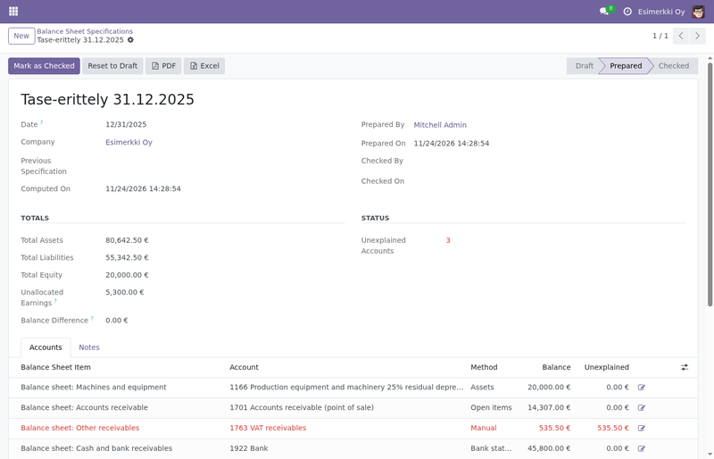
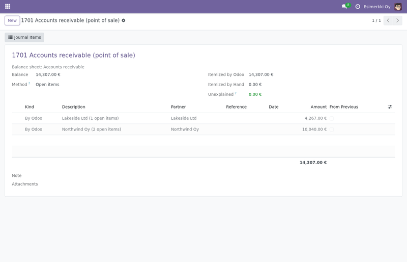
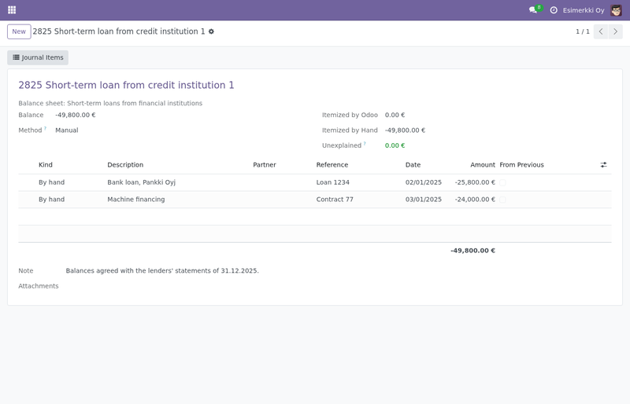

===========================
Balance Sheet Specification
===========================

.. 
   !!!!!!!!!!!!!!!!!!!!!!!!!!!!!!!!!!!!!!!!!!!!!!!!!!!!
   !! This file is generated by oca-gen-addon-readme !!
   !! changes will be overwritten.                   !!
   !!!!!!!!!!!!!!!!!!!!!!!!!!!!!!!!!!!!!!!!!!!!!!!!!!!!
   !! source digest: sha256:858028e165a3a27a010db7cc4acf66b50b329ec88b21e9dd4eda3213a5f5ebe1
   !!!!!!!!!!!!!!!!!!!!!!!!!!!!!!!!!!!!!!!!!!!!!!!!!!!!

.. |badge1| image:: https://img.shields.io/badge/maturity-Beta-yellow.png
    :target: https://odoo-community.org/page/development-status
    :alt: Beta
.. |badge2| image:: https://img.shields.io/badge/license-AGPL--3-blue.png
    :target: http://www.gnu.org/licenses/agpl-3.0-standalone.html
    :alt: License: AGPL-3
.. |badge3| image:: https://img.shields.io/badge/github-Cetmix--Nordic--Ltd%2Faccount--balance--sheet--specification-lightgray.png?logo=github
    :target: https://github.com/Cetmix-Nordic-Ltd/account-balance-sheet-specification/tree/18.0/account_balance_sheet_specification
    :alt: Cetmix-Nordic-Ltd/account-balance-sheet-specification

|badge1| |badge2| |badge3|

Balance sheet specification (in Finnish *tase-erittely*) for Odoo
Community: every balance sheet account on a closing date with its
balance and the items that make it up, signed off by the person who
prepared it and the person who checked it.

-  Accounts are grouped by their account tag (for example the balance
   sheet items of the Finnish chart of accounts of ``l10n_fi_oca``), or
   by account type when they have none.
-  Odoo itemizes what it can:

   -  receivable, payable and other reconcilable accounts: the items
      open on the date, per partner; payments made after the date do not
      count;
   -  bank and cash accounts: the closing balance of the last bank
      statement on or before the date.

-  Other accounts are explained by hand: items (for example loans or
   accruals), a note and attached documents. Each account shows what is
   still unexplained.
-  Items typed by hand are copied from the previous specification as a
   starting point.
-  States *Draft*, *Prepared* and *Checked*; a prepared or checked
   specification cannot be changed.
-  PDF and Excel reports.

More itemizations come with:

+----------------------------------+----------------------------------+
| Module                           | Itemizes                         |
+==================================+==================================+
| ``account_bal                    | Fixed asset accounts per asset   |
| ance_sheet_specification_asset`` | (``account_asset_management``)   |
+----------------------------------+----------------------------------+
| ``account_bal                    | Inventory accounts per product   |
| ance_sheet_specification_stock`` | category                         |
+----------------------------------+----------------------------------+

**Table of contents**

.. contents::
   :local:

Configuration
=============

Access: accounting administrators and accountants create and edit
specifications, read-only accounting users can read them.

To group the accounts by the items of the balance sheet, give the
accounts an account tag of the type *Accounts*. The Finnish chart of
accounts of ``l10n_fi_oca`` has them already.

Usage
=====

1. *Invoicing > Reporting > Balance Sheet Specifications > New*: give a
   name and the closing date, and click *Compute*. |Specification|
2. The *Accounts* tab lists the balance sheet accounts. Open an account
   (pencil button) to see the items Odoo computed, add items by hand,
   write a note and attach documents. *Unexplained* is the balance less
   the items. |Open items per customer| |Account explained by hand|
3. *Compute* again after new postings: the balances and Odoo's items are
   updated; items, notes and attachments added by hand stay.
4. *Mark as Prepared*, then the checker clicks *Mark as Checked*. *Reset
   to Draft* removes the sign-offs.
5. Print the specification with *PDF* or *Excel*.

Known issues / Roadmap
======================

-  Open items are summed per partner; the Excel report could list the
   individual documents.
-  The bank item compares with the last bank statement entered in Odoo,
   not with the bank's own balance.
-  Accounts are compared in the company currency only.

Changelog
=========

Bug Tracker
===========

Bugs are tracked on `GitHub Issues <https://github.com/Cetmix-Nordic-Ltd/account-balance-sheet-specification/issues>`_.
In case of trouble, please check there if your issue has already been reported.
If you spotted it first, help us to smash it by providing a detailed and welcomed
`feedback <https://github.com/Cetmix-Nordic-Ltd/account-balance-sheet-specification/issues/new?body=module:%20account_balance_sheet_specification%0Aversion:%2018.0%0A%0A**Steps%20to%20reproduce**%0A-%20...%0A%0A**Current%20behavior**%0A%0A**Expected%20behavior**>`_.

Do not contact contributors directly about support or help with technical issues.

Credits
=======

Authors
-------

* Cetmix Nordic Ltd

Contributors
------------

-  `Cetmix <https://cetmix.fi>`__:

   -  Jussi Lehto

Maintainers
-----------

This module is part of the `Cetmix-Nordic-Ltd/account-balance-sheet-specification <https://github.com/Cetmix-Nordic-Ltd/account-balance-sheet-specification/tree/18.0/account_balance_sheet_specification>`_ project on GitHub.

You are welcome to contribute.
