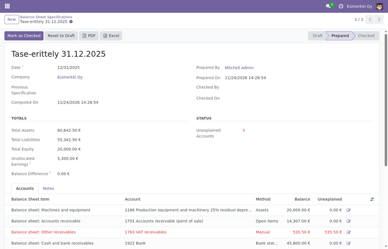
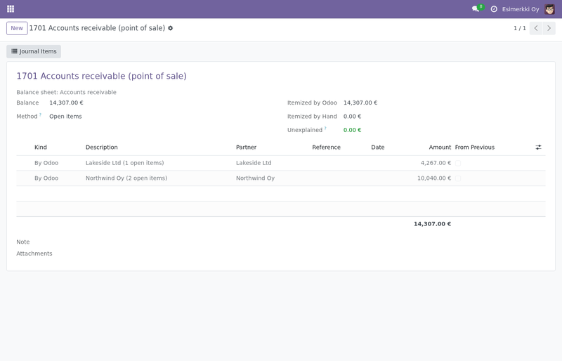
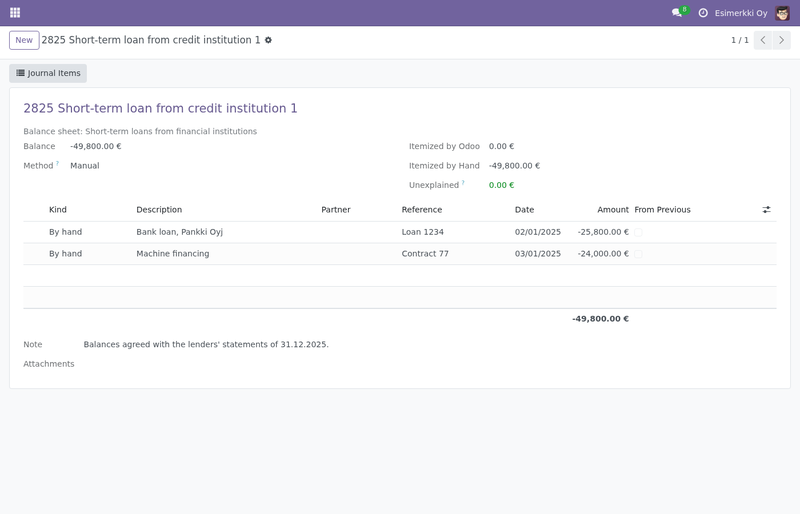

1.  *Invoicing \> Reporting \> Balance Sheet Specifications \> New*:
    give a name and the closing date, and click *Compute*.
    
2.  The *Accounts* tab lists the balance sheet accounts. Open an account
    (pencil button) to see the items Odoo computed, add items by hand,
    write a note and attach documents. *Unexplained* is the balance less
    the items.
    
    
3.  *Compute* again after new postings: the balances and Odoo's items
    are updated; items, notes and attachments added by hand stay.
4.  *Mark as Prepared*, then the checker clicks *Mark as Checked*.
    *Reset to Draft* removes the sign-offs.
5.  Print the specification with *PDF* or *Excel*.
